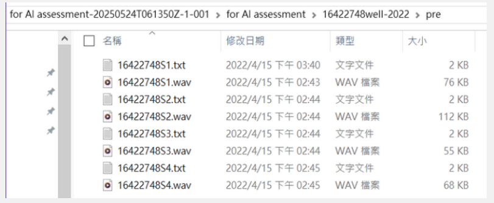
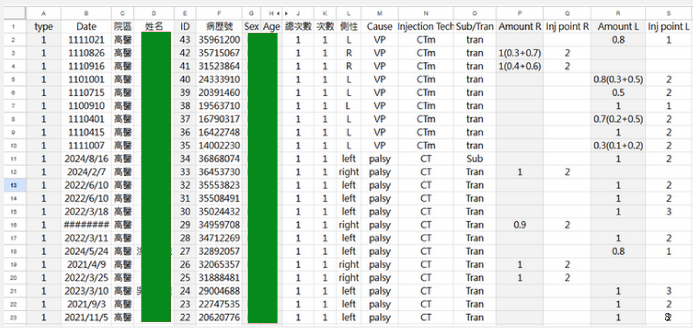
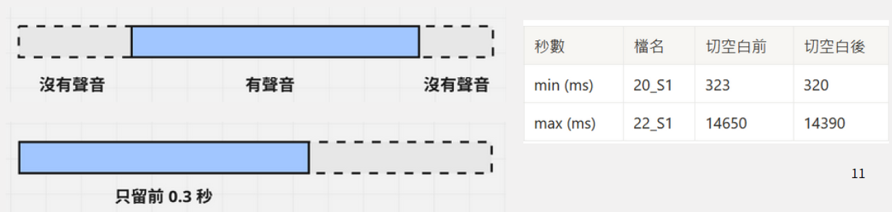
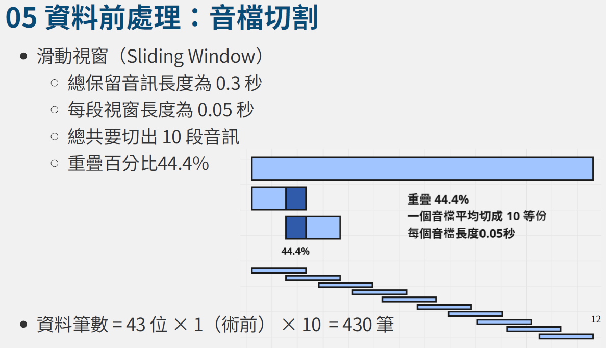
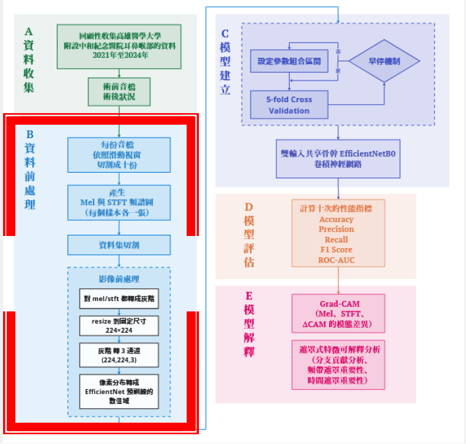
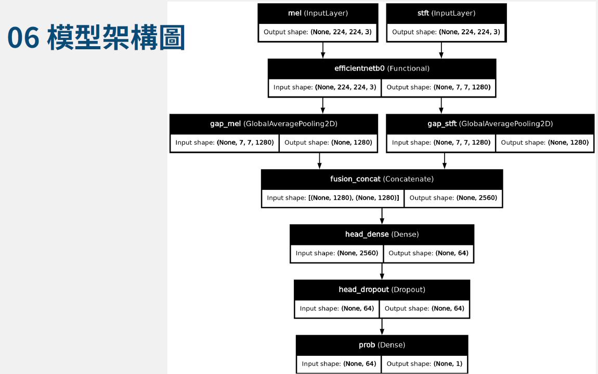
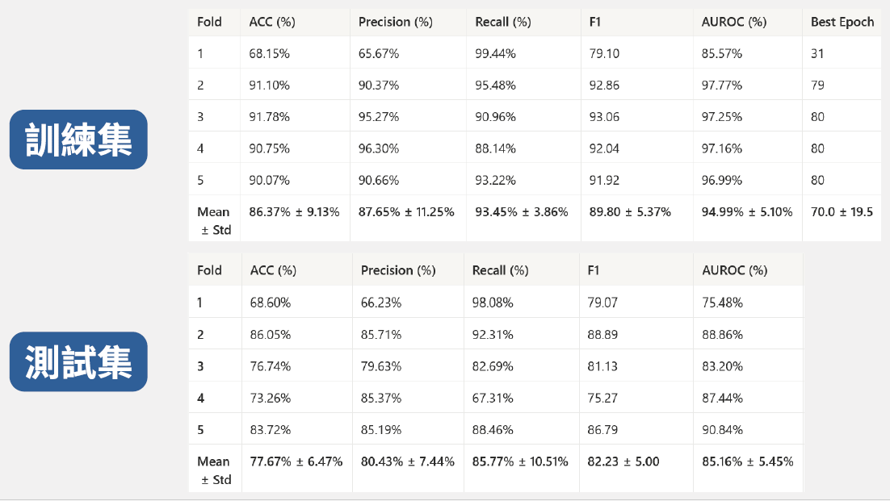
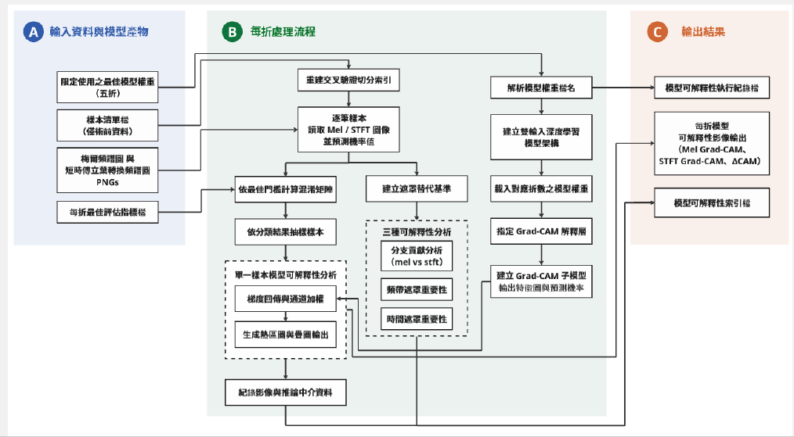
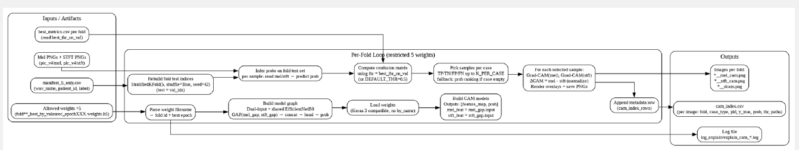

<p align="center">
  
</p>

<p align="center">
  <b>Course Final Project · Medical AI · Voice Analysis</b>
</p>

---

## 導覽列與章節快速跳轉

<p align="center">
  <a href="#1-專案範圍與免責聲明">專案範圍與免責聲明</a> | 
  <a href="#2-研究動機與臨床痛點">研究動機與臨床痛點</a> | 
  <a href="#3-資料收集與病人群體切分機制">資料收集與切分</a> | 
  <a href="#4-音檔切割與資料前處理工程">音檔切割與前處理</a> | 
  <a href="#5-階段一傳統機器學習與聲學特徵工程">階段一：機器學習</a> | 
  <a href="#6-階段二深度學習與雙輸入時頻圖建模">階段二：深度學習</a> | 
  <a href="#7-模型評估與效能指標分析">模型評估與效能</a> | 
  <a href="#8-模型解釋與可解釋性分析-xai">模型解釋與 XAI</a> | 
  <a href="#9-專案資料夾結構">專案資料夾結構</a> | 
  <a href="#10-資料可得性聲明與作者資訊">資料宣告與作者</a>
</p>

---

## 1. 專案範圍與免責聲明

本專案為臨床合作與課程期末專案，目的在於展示人工智慧模型於語音分析之方法設計與實作流程，**並非正式之臨床研究或經同儕審查之學術發表成果**。本專案僅作為學術展示與技術驗證用途，**不作為任何臨床決策或醫療建議之依據**。

---

## 2. 研究動機與臨床痛點

* **聲帶閉合功能障礙**：閉合功能健全的聲帶才能使人類發出穩定的聲音；閉鎖功能不全的病人（如聲帶麻痺及聲帶萎縮）會造成嚴重發聲困擾，甚至導致聲音吃力與沙啞。
* **臨床治療方式**：玻尿酸注射性喉成形手術是臨床上大幅改善閉合功能不全的重要微創治療方式。
* **臨床溝通痛點**：在實際醫療情境中，內視鏡檢查僅能告知病人需要進行手術，但患者與家屬最常詢問手術效果與聲音進步幅度，過去臨床上僅能給出質性回應。
* **人工智慧介入價值**：本專案旨在透過人工智慧建模，依據患者手術前的聲音檢測資料精準預測術後發聲預後狀況，藉此提升臨床資源利用率與病患溝通品質。

---

## 3. 資料收集與病人群體切分機制

* **資料來源與規模**：資料集來自高雄醫學大學附設中和紀念醫院耳鼻喉部曾馨儀主治醫師，回顧性收集 2021 年至 2024 年之臨床與語音紀錄，臨床回溯性資料庫總共有 43 位病人。
* **病人層級切分機制**：本專案遵循機器學習黃金比例，以病人層級進行隨機抽樣，嚴格避免同一病人之多筆切片同時出現在訓練集與測試集而導致資料洩漏：
  * **訓練集**：約佔 80%，共 34 位病人。
  * **測試集**：約佔 20%，共 9 位病人。
  * *(註：34 人乘以 10 份切片等於 344 筆訓練樣本；9 人乘以 10 份切片等於 86 筆測試樣本，總計 430 筆切片樣本。)*
* **原始資料敘述視覺化**：
  <p align="center">
    
    
  </p>

---

## 4. 音檔切割與資料前處理工程

* **音檔前處理與滑動視窗策略**：
  * 為了解決小樣本資料量不足之限制，本專案選用母音 A 之術前音檔進行深度時頻圖建模。
  * 設定能量門檻過濾前後無聲雜訊，僅保留前 0.3 秒有效語音區段。
  * 採用滑動視窗策略，每段視窗長度為 0.05 秒，總保留音訊長度 0.3 秒，重疊百分比為 44.4%，將每份音檔平均切成 10 等份，擴增樣本數至 430 筆。
* **時頻圖與影像前處理流程**：
  * 針對每個切片樣本分別產生 Mel 頻譜圖與短時傅立葉轉換頻譜圖。
  * 針對音檔過短容易導致整圖單色之問題，將 Mel 與 STFT 圖像強制轉為灰階。
  * 統一縮放尺寸至 224 乘以 224 解析度，並將灰階影像擴展轉換為 3 通道格式，對齊預訓練模型之數值域。
* **音檔切割與前處理視覺化**：
  <p align="center">
    
    
  </p>

---

## 5. 階段一：傳統機器學習與聲學特徵工程

本階段著重於結構化表格資料的特徵萃取與經典機器學習模型的探索。

* **模型選擇與架構考量**：
  * **羅吉斯迴歸基準模型**：聲學特徵與臨床特徵具備高度物理可解釋性。採用線性基準模型能快速檢視各項特徵與預後結果之線性關聯，作為後續複雜模型的效能對照基準。
  * **樹狀與集成學習模型**：考量聲學數值與臨床屬性屬於表格型結構化資料，隨機森林、極限梯度提升與自適應提升等集成演算法在處理表格資料時具備先天優勢，能有效捕捉特徵間的非線性交互作用，且配合貝氏最佳化調參效率極佳。
* **實作重點**：萃取 27 維聲學特徵向量，處理缺失值並導入貝氏最佳化搜尋最佳超參數組合，執行多模型交叉驗證與特徵重要性解析。

---

## 6. 階段二：深度學習與雙輸入時頻圖建模

為克服傳統手動特徵可能遺漏細微頻譜動態之限制，本專案進一步引入影像化時頻圖與深度神經網路建模。

* **模型架構與設計理念**：
  * **時頻圖特徵自動學習**：捨棄手動計算限制，直接將音訊轉換為 Mel 頻譜圖與短時傅立葉轉換頻譜圖，交由卷積神經網路自動擷取底層的紋理與頻帶結構特徵。
  * **輕量化骨幹網路選型**：考量醫療資料樣本數有限，若從頭訓練大型網路極易產生過擬合。因而採用 EfficientNetB0 作為特徵擷取核心，其具備參數少與複合縮放特點，極適合應用於遷移學習。
  * **雙輸入共用骨幹融合機制**：Mel 頻譜圖貼近人耳感知，而短時傅立葉轉換頻譜圖保留物理線性細節。本專案讓兩者共用同一 EfficientNetB0 骨幹，強迫模型學習雙模態之互補資訊，並於特徵層進行融合。
* **整體系統架構與模型架構圖**：
  <p align="center">
    
  </p>
  <p align="center">
    
  </p>

---

## 7. 模型評估與效能指標分析

* **評估指標**：採用混淆矩陣、準確率、精確率、召回率、F1 分數以及受試者工作特徵曲線下面積作為核心量化指標。
* **五折交叉驗證測試集表現**：
  * **準確率 (Accuracy)**：77.67% ± 6.47%
  * **精確率 (Precision)**：80.43% ± 7.44%
  * **召回率 (Recall)**：85.77% ± 10.51%
  * **F1 分數 (F1 Score)**：82.23% ± 5.00%
  * **曲線下面積 (AUROC)**：85.16% ± 5.45%
* **模型評估結果視覺化**：
  <p align="center">
    
  </p>

---

## 8. 模型解釋與可解釋性分析 (XAI)

* **梯度加權類別啟用圖與模態差異分析**：
  * 運用梯度資訊定位模型在頻譜影像中最敏感的時頻關注區域。
  * 透過兩者差值分析模態差異，證實模型在低至中頻區段對 Mel 頻譜具備強主導性。
* **遮罩式特徵重要性分析**：
  * 透過遮蔽不同分支與時頻區段，驗證模型決策高度依賴特定時間窗內的聲學型態。
* **可解釋性分析架構視覺化**：
  <p align="center">
    
    
  </p>

---

## 9. 專案資料夾結構

本專案採用模組化軟體工程設計，目錄結構規劃如下：

```text
ai-laryngeal-injection-outcome-prediction/
│
├── assets/                  # 存放所有系統架構圖、音檔切割與 XAI 視覺化圖檔
├── data/                    # 示範資料與欄位說明文件（不包含任何臨床個資）
├── notebooks/               # 實驗探索、特徵工程與模型調校 Jupyter Notebooks
├── src/
│   ├── __init__.py
│   ├── preprocessing/       # 音檔能量切割、Mel/STFT 轉換與聲學特徵萃取模組
│   ├── models/              # EfficientNet 雙輸入架構與機器學習分類器訓練模組
│   ├── evaluation/          # 交叉驗證、混淆矩陣計算與閾值最佳化腳本
│   └── explainability/      # Grad-CAM 視覺化與 SHAP 特徵重要性分析模組
│
├── requirements.txt         # 專案相依套件清單
├── Dockerfile               # 容器化部署設定檔
└── README.md                # 專案首頁說明文件

## 10. 資料可得性聲明與作者資訊

### 資料可得性聲明 (Data Availability Statement)
基於病人隱私保護、臨床研究倫理與個人資料保護法規之嚴格規範，本專案所使用之**原始臨床音檔與電子病歷資料均受到嚴格保護，恕無法對外公開**。本 GitHub 專案僅提供去識別化之方法學架構、特徵工程邏輯與模型實作流程展示，藉此確保符合醫療資訊安全與去識別化規範。

### 作者與研究團隊 (Authors and Collaborators)
本專案由醫學資訊與臨床醫療團隊跨域合作完成，研發貢獻與署名資訊如下：

* **核心研究者與系統開發**：
  * **Sha Huang (黃筱雯)** — 高雄醫學大學 醫務管理暨醫療資訊學系碩士  
  * **貢獻**：負責整體人工智慧模型架構設計、雙輸入深度學習與機器學習管道實作、聲學特徵工程、可解釋性分析，以及專案開源與技術文件編撰。

* **臨床指導與資料提供**：
  * **曾馨儀 主治醫師** — 高雄醫學大學附設中和紀念醫院 耳鼻喉部  
  * **協助**：提供回顧性臨床音訊與病歷資料、定義臨床核心痛點，並針對模型預測結果進行醫療合理性與臨床應用價值驗證。

* **學術指導與專案監督**：
  * **何文獻 教授** — 高雄醫學大學 醫務管理暨醫療資訊學系  
  * **協助**：提供研究方向指導、語音資料標註原則方法設計建議及整體學術架構之把關。

<p align="center">
  
</p>
